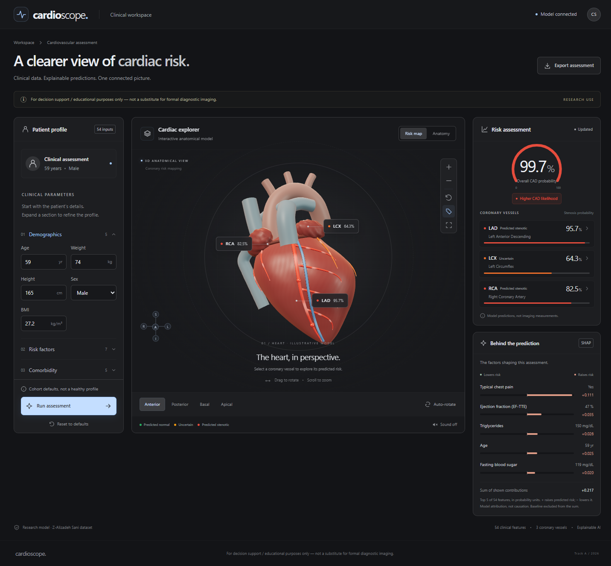

# CardioScope

Track A | Multimodal AI Hackathon 2026 | Technical report

Source: https://github.com/vaibhavitej-a11y/CardioScope

## 1. Product overview and architecture

CardioScope is a research prototype that estimates coronary artery disease
(CAD) and vessel-specific stenosis probabilities from 54 clinical features.
An interactive 3D heart connects those estimates to anatomical context, while
SHAP explanations show the factors behind each model output.

**For decision support / educational purposes only — not a substitute for formal diagnostic imaging.**

| Layer | Technology | Responsibility |
| --- | --- | --- |
| Frontend | React 19, TypeScript, Vite 8, Tailwind 4, Zustand | Patient form, scores, explanations, print export |
| Anatomy | Three.js, React Three Fiber, Drei | Procedural heart, coronary vessels, labels, camera controls |
| API | FastAPI, Pydantic | Validate 54 inputs; serve four model probabilities and explanations |
| Models | CatBoost, scikit-learn, SHAP | Four independent binary classifiers and probability-unit attributions |

Data flows from the controlled form through POST /api/predict to the stored
pipelines, then back to the dashboard and anatomical viewer. Vite proxies /api
to FastAPI on port 8001. No database, API keys, cloud inference, or downloaded
anatomical assets are needed during normal use.



Figure 1. Patient inputs, interactive anatomy, predicted probabilities, and
feature contributions in one workspace. The illustrated heart is not a patient scan.

## 2. Dataset and preprocessing

The included public workbook is the UCI Extension of Z-Alizadeh Sani dataset
(repository ID 411; DOI 10.24432/C5461K), attributed to Z-Alizadeh Sani et al.
under CC BY 4.0. The original workbook is stored unmodified in ml/data/raw/.

| Property | Recorded value |
| --- | --- |
| Records | 303 patients |
| Original columns | 59 |
| Targets | Cath (overall CAD), LAD, LCX, RCA |
| Model inputs | 54, after excluding four targets and one constant |
| Missing values in the included workbook | 0 |

The clinical inputs cover demographics, risk factors, comorbidities,
examination, symptoms, ECG, laboratory measurements, and echocardiography.
Exertional CP is constant in the source dataset and is excluded. Cath, LAD,
LCX, and RCA are answers, never predictor inputs. Tests enforce this exclusion
and the API rejects unexpected fields.

ml/src/data.py defines explicit numeric and categorical columns instead of
guessing from storage types. Region RWMA is treated as a categorical finding,
not an anatomical coordinate. Targets are mapped to binary labels with guards
against unknown values.

Each trained model includes its preprocessing pipeline. Numeric inputs receive
median imputation and scaling; categorical inputs receive most-frequent
imputation and one-hot encoding with unknown-category handling. Fitting
preprocessing inside the cross-validation pipeline prevents validation folds
from influencing their own transformations.

The schema emitted by training, the Pydantic API fields, and the frontend
catalogue must contain the same 54 inputs. Cross-artifact tests check their
names and numeric/categorical types. The original dataset hash is recorded in
ml/artifacts/manifest.json for provenance.

## 3. Models, validation, and explainability

Four independent classifiers estimate CAD, LAD, LCX, and RCA outcomes. The
training pipeline evaluates LightGBM, XGBoost, and CatBoost, with logistic
regression reported as a baseline. The shipped models are all CatBoost.
Class weighting addresses the source dataset's imbalance.

Selection uses five stratified cross-validation folds with seed 42.
Preprocessing is fitted inside each fold. There is no independent held-out
test set: metrics summarize cross-validation on the 303-record research dataset.

| Target | ROC-AUC | F1 | Precision | Recall | Accuracy |
| --- | --- | --- | --- | --- | --- |
| CAD / Cath | 0.912 | 0.900 | 0.887 | 0.912 | 0.855 |
| LAD | 0.849 | 0.819 | 0.797 | 0.842 | 0.782 |
| LCX | 0.739 | 0.617 | 0.640 | 0.597 | 0.710 |
| RCA | 0.703 | 0.507 | 0.558 | 0.465 | 0.660 |

These are the recorded pooled out-of-fold results at the default operating
point. Fold statistics and separately reported tuned operating points are
available in ml/artifacts/metrics.json. Threshold tuning uses an inner
cross-validation procedure within outer training splits; the validation fold
does not choose its own threshold.

SHAP TreeExplainer attributes each prediction in probability units. One-hot
contributions are aggregated back to the original 54 clinical feature names.
Model selection excludes candidates that cannot support the required
interventional_probability explanations in the recorded environment; the
manifest records those capability checks.

The dashboard displays the top five signed contributions with the assessed
measurements. Positive values raise the model output; negative values lower it.
Their displayed sum excludes the model baseline and undisplayed features.
Attribution is not causation. Tests check consistent SHAP units and the
prediction/explanation contract across all four saved model bundles.

## 4. Anatomical visualization and interaction

The heart is built procedurally: a warped ventricular surface, atrial
appendages, great vessels with recessed openings, cardiac veins, and tapered
coronary arteries with illustrative side branches. Muscle texture and lighting
are generated locally; no model download or external texture is required.

Vessel routes and surface geometry share the same shape functions so the
arteries follow the muscle. A subtle heartbeat moves the organ and its
attachments together. Animated light bands suggest flow without an expensive
fullscreen postprocessing pass.

LAD, LCX, and RCA use shared identifiers throughout the response types, store,
cards, labels, tubes, and selectable nodes. A new assessment updates their
probability colors together. Selecting any vessel representation scopes the
explanation panel to that vessel; selecting it again clears the selection.

| Interaction | Behavior |
| --- | --- |
| Drag / scroll | Orbit the heart / change zoom |
| Camera presets | Anterior, posterior, basal, and apical views |
| Anatomical compass | L/R, S/I, and A/P project from patient-space axes using the current camera orientation |
| Labels / risk map | Toggle vessel labels or switch to neutral anatomy colors |
| Expanded view | Focus on the heart; Escape returns to the workspace |
| Optional sound | Explicitly enable a synthesized illustrative heartbeat |

Green, amber, and red communicate lower, uncertain, and higher vessel
probability bands. These display bands are not model operating thresholds or
measured stenosis severity. Overall CAD uses likelihood wording rather than
calling the entire heart stenotic.

Device pixel ratio is capped at 1.5. Continuous rendering pauses when the
viewer is outside the viewport; reduced-motion preferences stop automatic
animation. The viewer has a fallback when WebGL is unavailable. Keyboard
focus is contained in the native welcome dialog and expanded viewer.

The anatomy is schematic. The dataset has no lesion coordinates, so colors
apply to vessels and their illustrative branches, not to localized plaque.

## 5. Reproducing the application

Use Node.js 24 LTS and Python 3.13. The committed model manifest records
Python 3.13.14. Exact Python requirements and project transitive dependencies
are pinned in constraints.txt; frontend dependencies use package-lock.json.

From the repository root, install once on Windows:

```powershell
python -m venv .venv
.\.venv\Scripts\python.exe -m pip install -r requirements.txt
npm.cmd --prefix web ci
```

Open two terminals. Terminal A starts the API:

```powershell
.\.venv\Scripts\python.exe -m uvicorn app.main:app --app-dir api --port 8001
```

Terminal B starts the frontend:

```powershell
npm.cmd --prefix web run dev
```

Open the URL Vite prints, normally http://localhost:5173. Wait for API startup
to complete, then confirm Model connected in the header. The optional
start-api.ps1 helper locates a runtime matching the saved model versions.
On macOS/Linux, use .venv/bin/python and npm; see the root README for commands.

GET /api/health verifies that all four models have loaded. The same request
through the frontend verifies the proxy. POST /api/predict accepts exactly the
54 allowed inputs and returns CAD/vessel probabilities plus SHAP breakdowns.

Training is optional: the committed artifacts already run the application.
To regenerate them, stop the API, run ml/src/train.py with the project Python,
review the changed artifacts, rerun tests, and restart the API.

Production-build review uses npm.cmd --prefix web run build followed by
npm.cmd --prefix web run preview. Keep the API running; preview also proxies
/api to port 8001. The root Dockerfile builds React and serves it from FastAPI
alongside the real models on one origin. render.yaml configures hosting;
deploy/verify.py checks assets and input-dependent inference over HTTP.

## 6. Verification, safety, and limitations

The repository includes Python checks covering API responses, input
boundaries, feature schema/disclaimer parity, leakage, trained bundles, and
SHAP units, and dependency pins against the saved model manifest. Frontend regression tests cover probability precision, rounding
boundaries, and separate CAD/vessel labels. Type checking and linting are part
of the submission checks. HTTP checks verify the compiled frontend and real
input-dependent predictions. Browser interaction and integrated-GPU performance
remain final manual checks.

```powershell
npm.cmd --prefix web test
npm.cmd --prefix web run lint
npm.cmd --prefix web run build
.\.venv\Scripts\python.exe -m pytest api/tests ml/tests -q
```

Probabilities show one decimal place: 99.68% displays as 99.7%, not 100%.
Extremely small or large values display as <0.1% or >99.9%. The prefilled
profile includes hypertension and typical chest pain; cohort defaults are
not a healthy reference case. Editing fields marks results stale until the
next assessment; explanations retain their original measured inputs.

If the API is unavailable, an explicitly labeled sample assessment offers a
canned preview. It does not calculate new predictions from edited inputs.
Research disclaimers are visible in the welcome dialog, banner, and footer.

**Limitations:** the dataset is small, LCX/RCA discrimination is weaker than
CAD/LAD, and cross-validation does not establish prospective clinical utility
or calibrated certainty. Anatomy is illustrative and predictions are
vessel-level. No hosted deployment or recorded demo is claimed by this report.

Future work includes calibration assessment, larger external datasets,
prospective validation, and imaging modalities. Public repository visibility,
the English-language 3–10 minute YouTube demonstration, and team registration
must be completed separately before submitting on Devpost.

For decision support / educational purposes only — not a substitute for formal diagnostic imaging.
